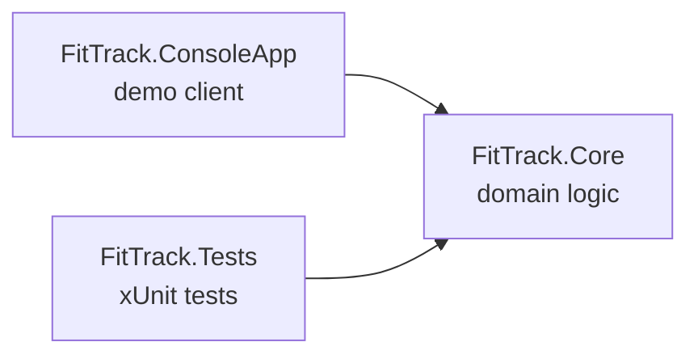

<h1 align="center">FitTrack</h1>

<p align="center">
  A gym management backend written in C# and .NET 10.<br>
  Members, memberships, training sessions and bookings, with the business rules covered by automated tests.
</p>

---

**Status:** Phases 1 and 2 are complete (console application, `FitTrack.Core` library and automated tests). Phase 3, the Web API, is next.

<h2>About</h2>

FitTrack is a server that stores gym data and exposes an API that any frontend (website, mobile app) can use. It is a simplified take on products like PushPress: members, memberships, training sessions and bookings, without card payments or marketing features.

The project is built in phases: first the domain model and business rules, then automated tests, then a Web API with a database, authentication and deployment.

<h2>Features</h2>

| Feature | Description |
|---|---|
| Roles | Admin, Trainer and Member, with role checks in the business rules |
| Bookings | A member can book a session only with an active membership on the session date, if not already booked, and if the session is not full or started |
| Cancellations | Only the owner can cancel, and at least 48 hours before the session |
| Memberships | A new membership starts after the member's current one, so coverage never overlaps. Plans with a non-positive duration are rejected |
| Discounts | 10% for plans of 90 days or more, 20% for 365 days or more, implemented as a `switch` expression |
| Statistics | Active members, total revenue and revenue by plan, session occupancy, expiring memberships, members without bookings |
| Events | `SessionFilled` when the last spot is taken, `MembershipExpired` when a member loses coverage |
| Daily expiry check | Marks ended memberships once and notifies only if the member has no later membership |

<h2>Architecture</h2>



Dependencies point one way: the console app and the tests use `FitTrack.Core`, never the other way around. Services depend on `IRepository<T>` rather than on a concrete storage, so the in-memory repository can be replaced by a database in Phase 3 without changing the business logic.

```
FitTrack.slnx
src/
├── FitTrack.Core              domain logic, no UI dependencies
│   ├── Models                 User, MembershipPlan, Membership, TrainingSession, Booking, report records
│   ├── Repositories           IRepository<T> and InMemoryRepository<T>
│   ├── Services               BookingService, MembershipService, StatisticsService
│   └── Exceptions             BookingException, MembershipException
└── FitTrack.ConsoleApp        demo application
    ├── Services               NotificationService (writes notifications to the console)
    └── Program.cs             demo scenarios for every business rule
tests/
└── FitTrack.Tests             xUnit tests for the Core library
```

<h2>Getting started</h2>

Requires the [.NET 10 SDK](https://dotnet.microsoft.com/download).

```bash
git clone https://github.com/Mr-igi/FitTrack.git
cd FitTrack
dotnet run --project src/FitTrack.ConsoleApp
```

The demo runs scenarios for bookings, cancellations, purchases, statistics and the expiry check, and prints `[OK]`, `[FAIL]` and `[NOTIFY]` lines.

<details>
<summary>Example output</summary>

```
--- Booking ---
[OK]   Milos books CrossFit -> booking #1
[FAIL] Milos books CrossFit again -> You are already booked for this session.
[NOTIFY] Trainer Marko Jovanovic: "CrossFit" on 2026-10-20 18:00 is now full.
[OK]   Petar books CrossFit -> booking #2

--- Expiration check ---
Checking on 2026-11-05...
[NOTIFY] Petar Ilic: your membership expired on 2026-10-30.
Marked 3 membership(s) as expired.
```

</details>

<h2>Tests</h2>

```bash
dotnet test
```

The test project has more than 70 automated tests covering booking and cancellation rules, membership purchase and stacking, expiry and events, plan discounts and every statistics report.

- Every test follows Arrange, Act, Assert: it prepares its own data, calls one method and checks the result.
- Test names follow `Method_Condition_ExpectedResult`, for example `BookSession_WhenSessionIsFull_Throws`.
- Boundary cases are tested explicitly, such as exactly 48 hours before a session or a membership that ends today.
- `[Theory]` tests run one method with several inputs, for example discount percentages for different plan durations.
- Event tests subscribe to the event and check what was raised and how many times.
- Services receive `now` and `today` as parameters instead of reading the system clock, so tests are deterministic.

<h2>What I learned</h2>

| Area | Topics |
|---|---|
| Object-oriented design | Domain models, business rules in services, custom exceptions, constructor dependency injection |
| Generics | A reusable `IRepository<T>` with an in-memory implementation |
| LINQ | `Where`, `Select`, `GroupBy`, `OrderBy`, `Sum`, `Distinct`, deferred versus immediate execution |
| Events | `Action<T>` events, subscribing with `+=`, raising events after the state is saved |
| Modern C# | `record` types, `with` expressions, `switch` expressions, `DateOnly`, `required` members |
| Project structure | A class library, a console app and a test project with one-directional dependencies |
| Testing | xUnit, `[Fact]` and `[Theory]`, `Assert.Throws`, boundary tests, writing a failing test first |
| Refactoring | Making a property `required` and using the compiler to find every place to update |
| Git workflow | Feature branches, pull requests, meaningful commit messages |

<h2>Roadmap</h2>

| Phase | Goal | Status |
|---|---|---|
| 1 | Console application with domain model and business rules |✅ Done |
| 2 | `FitTrack.Core` library and xUnit tests for every rule |✅ Done |
| 3 | Web API: EF Core and database, controllers, DTOs, JWT authentication with roles, Swagger | Next |
| 4 | Background service, Serilog, Docker, GitHub Actions CI, deployment to Azure | Planned |
| 5 | Optional React frontend connected to the API | Planned |